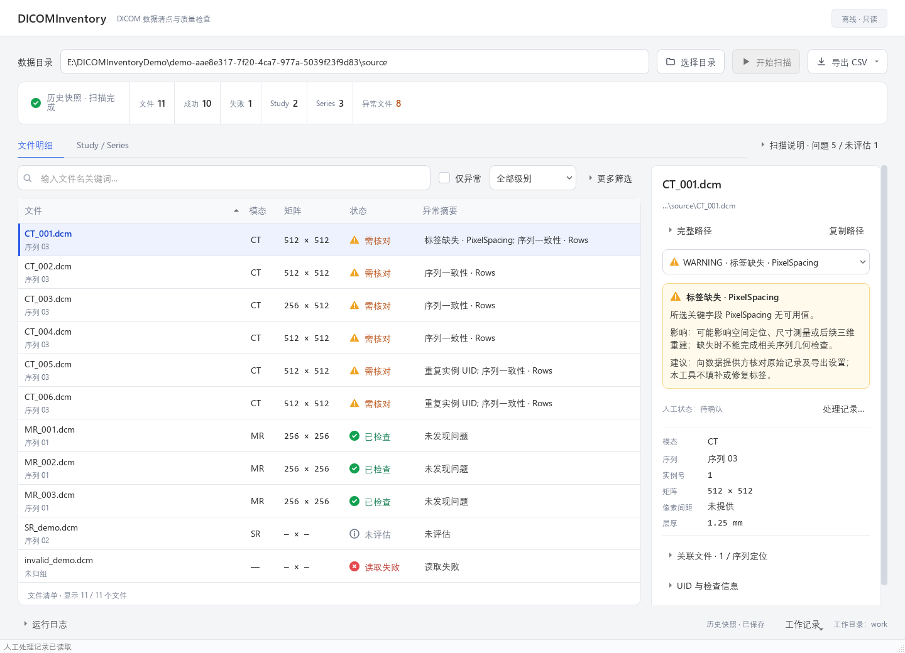

# DICOMInventory

离线、只读的 DICOM 数据清点与质量审阅工具。

面向影像数据准备与临床工程核对，帮助使用者从文件清点开始，发现并解释元数据问题，记录人工处理，再通过复检对比跟踪问题变化。

- 分层审阅：文件明细与Study/Series/File层级，查看异常、检查证据和关联文件。
- 问题跟踪：保存扫描记录、人工状态、备注及变更审计。
- 复检对比：比较前后问题、文件和数量变化，在证据充分时关闭或重开问题。
- 清单导出：支持文件、序列、问题和复检对比四类CSV。

版本V1.4，基于Python、pydicom和PySide6，无需GPU或在线模型。主程序不修改原始DICOM，默认不读取像素；不用于阅片诊断、自动修复、匿名化或完整DICOM合规认证。



截图来自真实Qt软件的离屏合成演示，不含真实患者数据。样例是没有PixelData的元数据文件，不能用于阅片或重建。

## 安装与启动

系统要求：Windows 10/11，64位Python 3.12。当前提供源码，没有exe安装包。

在项目根目录（与requirements.txt同级）打开PowerShell，先用Python版本命令确认环境：

```powershell
python --version
python -m venv .venv
& ".\.venv\Scripts\python.exe" -m pip install -r requirements.txt
& ".\.venv\Scripts\python.exe" -m dicom_inventory
```

Python版本应为3.12。安装了多个版本且有Windows启动器时，可用`py -3.12 -m venv .venv`代替创建环境的命令。已有虚拟环境可跳过创建和安装。首次安装依赖可能需要网络，软件扫描和记录功能离线运行。

## 快速体验

生成一份新的合成样例：

```powershell
& ".\.venv\Scripts\python.exe" -m tools.synthetic_demo create --output ".demo"
```

命令打印三个路径：DEMO_ROOT是本次演示根目录，SOURCE是待扫描样例，WORK是独立工作目录。

1. 在软件中点击“选择目录”，选择SOURCE，等待候选文件发现完成。
2. 点击“开始扫描”。初始样例有11个候选文件、5项问题；查看文件明细或切换“Study / Series”。
3. 选择一行，在右侧阅读问题事实、可能影响、建议和检查证据。
4. 打开底部“工作记录 → 选择独立工作目录…”，选择WORK，再点击“保存本次扫描”。
5. 从“工作记录 → 问题处理清单…”记录状态或备注；顶部“导出 CSV”可导出完整批次清单到独立目录。

每次生成新UUID案例，不覆盖已有演示。样例故意包含异常，只用于验证工程流程。完整复检、取消、批量处理、历史恢复和审计步骤见[用户操作手册](docs/USER_GUIDE.md)；合成阶段切换见[演示指南](docs/DEMO_GUIDE.md)。

## 文档

- [用户操作手册](docs/USER_GUIDE.md)：按实际按钮和菜单说明全部现有用户操作，含常见问题排查。
- [合成演示操作指南（含5分钟讲解提纲）](docs/DEMO_GUIDE.md)：样例生成、阶段切换和自动回放，不含演示视频。
- [技术参考](docs/TECHNICAL_REFERENCE.md)：对象适用范围、规则与容差、问题键、存储和CSV字段、Python接口。
- [项目定位](docs/PROJECT_OVERVIEW.md) · [版本说明](docs/RELEASE_NOTES.md) · [验证记录](docs/VALIDATION.md)。
- [维护者发布核对清单](docs/PUBLISH_CHECKLIST.md)。

## 开发与测试

安装开发依赖后运行测试：

```powershell
& ".\.venv\Scripts\python.exe" -m pip install -r requirements-dev.txt
$env:QT_QPA_PLATFORM = "offscreen"
$env:QT_QPA_FONTDIR = "C:\Windows\Fonts"
& ".\.venv\Scripts\python.exe" -B -m pytest -q -p no:cacheprovider
```

2026-10-14完整应用回归359项通过，原生退出0；测试使用合成数据。具体版本、专项检查、文档校验及验证范围见[验证记录](docs/VALIDATION.md)。

## 安全与适用边界

影像字段与几何规则支持所选传统单帧CT/MR，其他对象明确标注未评估。“读取成功”不等于质量通过，“未评估”也不等于通过；取消、文件删除或问题数量减少不能单独证明问题已解决。

工作数据库和导出文件写入独立目录。虽然不请求患者姓名、编号和出生日期等直接身份标签，路径、UID、其他文本和人工备注仍可能识别来源。工具不执行匿名化，不应在仓库中保存真实DICOM、工作数据库或导出报告。

尚无像素质量检查、完整内容指纹、多帧几何、多机同步、操作者认证或防篡改审计。合成验收不构成真实临床验证。

## 许可

本项目暂未提供LICENSE，也未声明开源许可。第三方依赖适用各自的许可证。
