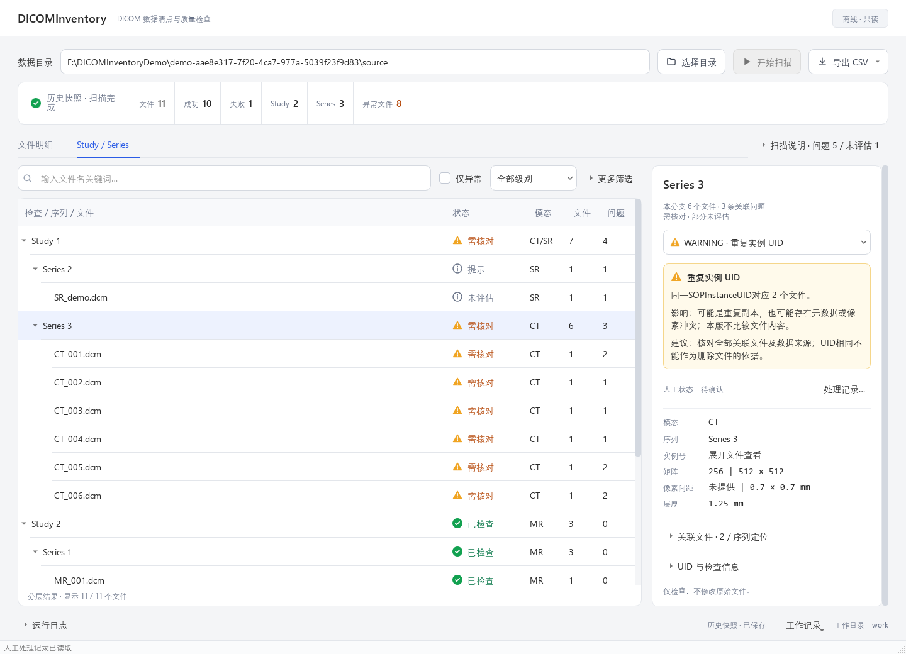
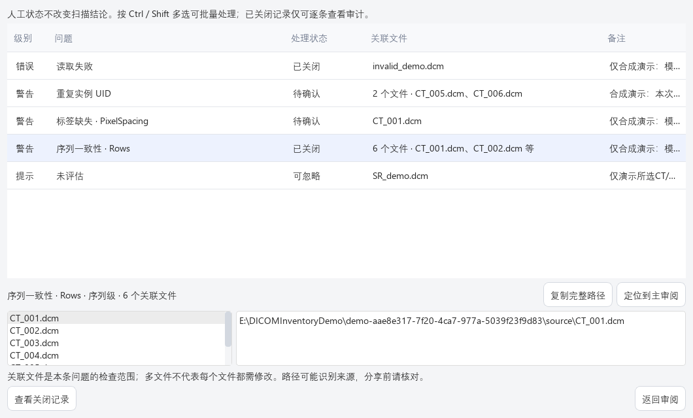
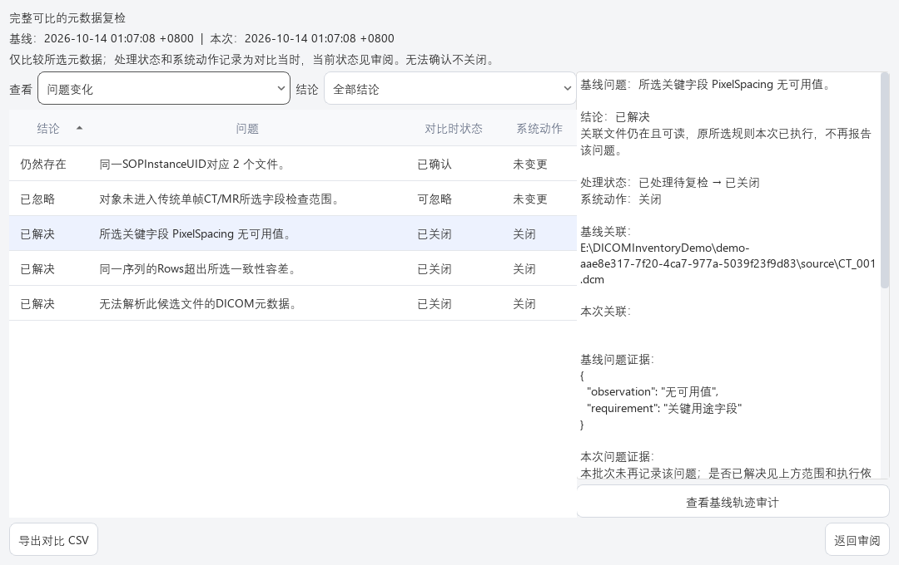

# 用户操作手册

适用于DICOMInventory V1.4原生Qt桌面界面。本文按实际按钮和菜单介绍用户操作；安装与启动见[README](../README.md)，检查规则、容差和Python接口见[技术参考](TECHNICAL_REFERENCE.md)。

## 目录

- [1. 使用前准备](#prepare)
- [2. 主界面与按钮](#screen)
- [3. 发现、扫描与取消](#scan)
- [4. 搜索、筛选、排序与分层审阅](#review)
- [5. 文件详情、证据与定位](#details)
- [6. 保存与打开扫描记录](#history)
- [7. 人工处理、批量备注与审计](#handling)
- [8. 基线、复检与对比](#recheck)
- [9. 导出四类CSV](#export)
- [10. 常见问题排查](#troubleshooting)
- [11. 功能边界与安全](#limits)

## 1. 使用前准备

先准备三个用途不同的目录：

| 目录 | 用途 | 要求 |
|---|---|---|
| 数据目录 | 待清点的DICOM文件 | 软件只读，不修改、删除、移动或修复 |
| 工作目录 | 保存扫描快照、人工记录和复检对比 | 首次使用选已存在的空文件夹；已有工作库选原目录；不能在数据目录及其子目录内 |
| 输出目录 | 保存CSV | 使用数据目录之外的独立目录；复检导出还要避开两批来源目录 |

首次体验可按[合成演示指南](DEMO_GUIDE.md)生成样例。SOURCE对应数据目录，WORK对应工作目录；DEMO_ROOT是两者的共同演示根目录，不是应扫描的SOURCE。

扫描不依赖在线服务，首次安装依赖可能需要网络。真实数据只能在有权使用的环境中处理；路径、UID和自由备注仍可能识别来源。

## 2. 主界面与按钮

图为真实软件的离屏合成演示，界面中的计数不是固定值。

| 区域 | 控件 | 用途 |
|---|---|---|
| 顶部 | 数据目录输入框、选择目录 | 选择或确认扫描来源 |
| 顶部 | 开始扫描、取消扫描 | 扫描已发现的候选清单，或请求安全停止 |
| 顶部 | 导出 CSV | 选择四类导出之一 |
| 汇总 | 扫描状态、文件/成功/失败/Study/Series/异常文件 | 查看本批次统计；扫描说明包含问题与未评估情况 |
| 页签 | 文件明细、Study / Series | 在五列表格和三级分层间切换 |
| 左侧 | 文件名搜索框、仅异常、全部级别、更多筛选 | 筛选当前视图 |
| 右侧 | 问题选择、完整路径、复制路径、处理记录… | 查看问题与关联目标，编辑人工记录 |
| 右侧 | 关联文件、序列定位、UID与检查信息 | 查看完整参数、规则执行、UID和检查证据 |
| 底部 | 运行日志、工作记录 | 查看任务信息；管理扫描、处理清单与复检 |

左右分栏可拖动分隔条调整比例；较矮窗口和长详情可纵向滚动。折叠信息区只收起内容，不代表数据缺失。

“工作记录”菜单共有以下操作：

| 菜单项 | 作用 | 前提 |
|---|---|---|
| 选择独立工作目录… | 初始化或打开本地工作库 | 软件没有正在运行的任务 |
| 保存本次扫描 | 保存完整或已取消的有效批次 | 工作目录已就绪、本批次未保存 |
| 打开已保存扫描… | 恢复历史快照 | 已选择工作目录且库中有记录 |
| 问题处理清单… | 查看并编辑当前批次的问题记录 | 当前批次已保存且有问题 |
| 选择复检基线… | 选择已保存的完整历史扫描 | 已选择工作目录且有完整批次 |
| 按基线重新扫描 | 同源重新发现、扫描、保存并比较 | 已选择与当前规则版本一致的基线 |
| 对比当前扫描… | 将已有当前批次与基线比较 | 基线和当前结果均存在，且不是同一批次 |
| 查看本次复检对比… | 重新打开已经加载的对比窗口 | 本次已生成或已加载对比 |
| 打开已保存复检对比… | 从工作库打开历史对比 | 已选择工作目录且有对比记录 |

任务执行期间，部分按钮会暂时禁用。按钮灰色表示操作条件尚未满足，不表示该功能被删除。

## 3. 发现、扫描与取消

### 3.1 发现与开始扫描

1. 点击“选择目录”，选择待扫描目录。也可以在数据目录输入框输入路径并按回车。
2. 等待后台递归发现完成。候选包括扩展名为.dcm/.dicom的文件，以及具有标准DICM文件头的其他文件。
3. 点击“开始扫描”，观察阶段/进度和逐步出现的文件结果。
4. 等待任务结束，再进行保存、导出或下一次扫描。

普通非DICOM文件会被忽略；扩展名符合但内容不可读的文件仍列为读取失败。单个文件读取失败不中断其他文件。

### 3.2 如何理解扫描结果

- 扫描完成：已发现的候选清单处理完成，不代表全部文件无问题，也不保证目录中的所有DICOM均被发现。
- 成功/失败：元数据解析成功或失败的文件数，成功不等于质量通过。
- 异常文件：有关联问题的文件去重数；一项问题可关联多个文件。
- 问题数量：结构化问题条数，不等于异常文件数量或重复UID组的文件数量。
- 未评估：相关对象或规则没有完成评估，不表示通过。

展开“扫描说明”，查看问题、未评估和批次范围限制。Study/Series基础统计按观测到的非空UID去重；未归组分支和非法UID的解释见技术参考。

### 3.3 取消扫描

1. 在发现、读取或检查阶段点击“取消扫描”。
2. 按钮显示“正在停止…”，等待当前读取返回及安全检查点，不强制结束进程。
3. 停止后显示“扫描已取消 · 未完成批次”，保留已尝试读取的记录。

即使文件已读完，后续检查被取消仍是未完成。取消后序列规则标为未评估，不能用较少的问题数证明质量通过。

取消的有效部分结果可保存或导出；再次扫描须重新选择目录，或在目录框按回车重新发现，不是断点续扫。保存/对比事务和CSV导出不提供中途取消，需等任务完成；软件忙碌时不能正常关闭。

意外扫描任务失败与主动取消不同：界面中的流式已读记录只供查看，不当作可保存或导出的有效扫描批次。

## 4. 搜索、筛选、排序与分层审阅

### 4.1 文件明细

点击“文件明细”页签。五列依次是文件、模态、矩阵、状态、异常摘要。文件列第二行是本批次序列显示编号，不是DICOM标识；实例号在右侧详情。

点击一行查看详情。点击文件表表头可切换该列的升序/降序；可拖动允许调整的列边界。排序只改变展示顺序，不改文件或扫描结果。

### 4.2 搜索和筛选

1. 在搜索框输入文件名的一部分，例如CT_001。搜索只匹配文件名，不搜索完整路径、UID、备注或问题描述；忽略大小写，自动忽略输入两端空格。
2. 勾选“仅异常”保留有关联问题的文件。未评估提示也可能被包含，并不等于文件损坏。
3. 用“全部级别”选择错误ERROR、警告WARNING或提示INFO。
4. 点击“更多筛选”，用“全部类型”选择问题类型，用“全部检查与序列”选择Study或Series范围。

条件同时生效；级别与类型须匹配同一项问题。两种视图使用同一组筛选条件；收起“更多筛选”不会清除已经选择的类型/范围，按钮会显示已启用数量。

恢复全部记录：清空搜索框、取消“仅异常”，级别选“全部级别”，展开“更多筛选”将类型选“全部类型”、范围选“全部检查与序列”。

筛选不改变扫描统计或导出范围。CSV始终包含该批次相应的完整已读结果，而非当前屏幕上的筛选行。

### 4.3 Study / Series

点击“Study / Series”页签，展开Study、Series，再选择文件。选择Study或Series时，右侧显示该分支的文件、模态、问题及总体状态；选择文件时显示文件详情。

未知/非法归属或读取失败保留未归组分支，不把空UID合并为一个真实Study/Series。存在跨Study的Series UID冲突时，分支计数与全标识范围应分别理解；各层问题数按问题键去重，不能直接相加。

键盘可用上下键移动选择，在分层树中用左右键展开/收起。主文件表一次选一行；Ctrl/Shift批量选择用于问题处理清单，不用于主文件表。

## 5. 文件详情、证据与定位

### 5.1 查看文件和多项问题

选择文件后，右侧显示文件名、简短路径、模态、序列、实例号、矩阵、像素间距和层厚。参数显示“未提供”或“未评估”时不自行补值。

一行可能关联多项问题；存在多个问题时，用右侧问题下拉框逐项查看事实、可能影响和建议。只有一项时直接显示，不需要下拉选择。

ERROR/WARNING/INFO是工程核对级别；“需核对”“已检查”“读取失败”“未评估”等展示状态不构成诊断结论。重复UID只说明标识重复，不证明文件内容相同或可以删除。

### 5.2 完整路径与复制

点击“完整路径”展开未省略的只读文本，或在短路径上悬停查看。点击“复制路径”复制完整文件路径；没有选中文件时不会复制上一条路径。

### 5.3 关联文件和序列定位

展开关联文件/序列定位区（标题可附文件数量），查看本项问题的全部关联文件：

- 双击关联文件，或选中后按回车，可定位到左侧对应文件。
- 点击“定位所属序列”，切到Study / Series并选中目标序列。
- 定位会清除可能遮挡目标的搜索、异常、级别、类型和范围筛选。

组级问题的关联文件是检查范围，不代表每个文件都应修改。

### 5.4 UID与检查信息

先展开“UID 与检查信息”，再展开需要的子项：

- “完整参数与逐规则评估”：所选元数据、序列规则是否执行及跳过原因。
- “UID 与较长技术信息”：Study/Series/SOP等标识与分类信息。
- “检查证据”：具体比较值、数量、范围或限制。

长文本可滚动，技术文本可选择复制。序列不同值汇总是预览，已导出的完整值集合见序列CSV。文件CSV只含技术参考列出的19列，可核对这些字段的逐文件值；SOPClassUID、FrameOfReferenceUID和ImageType不在文件CSV中，请查看右侧技术信息。FrameOfReferenceUID和ImageType的序列值集合也见序列CSV，但集合不表示逐文件对应关系。

## 6. 保存与打开扫描记录

### 6.1 选择工作目录和保存

1. 完成扫描，打开底部“工作记录 → 选择独立工作目录…”。
2. 首次使用选择已存在的空目录；后续选择已有工作库的原目录。不能选择原DICOM目录或其子目录。
3. 等待“工作目录已就绪”，点击“工作记录 → 保存本次扫描”。
4. 底部显示已保存后，再打开人工处理清单。

保存写入本地SQLite，不复制原DICOM或读取像素；不受视图筛选影响。同一批次重复保存拒绝，按钮通常已禁用。关闭软件不会自动保存当前未保存批次。

已取消批次亦可保存，保留未完成范围。工作目录不记入全局配置，重启后需重新选择原目录。

### 6.2 打开历史扫描

1. 选择原工作目录。
2. 打开“工作记录 → 打开已保存扫描…”。
3. 按时间、完成状态、文件数和问题数选择批次，核对下方数据来源。
4. 点击“打开记录”，或双击列表中的批次。

历史快照无需原数据目录在线。它不会重新读取原文件，也不自动复检或关闭问题；再次扫描须重新确认数据目录。打开历史可能替换当前未保存结果，弹窗确认前可返回并先保存。

历史显示的人工状态是该处理轨迹的当前状态，旧状态见审计；历史对比保存的是对比当时状态。时间按电脑本地时区显示偏移，批次/原时间等信息可通过界面提示或详情核对。

工作库支持旧结构事务升级，较新或外部不兼容结构会拒绝。没有历史删除、数据库降级、自动备份、多机同步或加密功能。

## 7. 人工处理、批量备注与审计

人工处理只记录判断，不修改文件、扫描事实或异常统计。

### 7.1 单条问题

当前扫描保存后，在右侧选择问题并点击“处理记录…”，或从“工作记录 → 问题处理清单…”选择一条，点击“编辑所选问题”。

1. 核对问题名称、作用范围和关联文件。
2. 点击“查看全部目标文件与路径…”可在独立只读窗口核对所有文件和完整路径；“返回编辑”回到表单。
3. 选择处理状态，填写备注/忽略理由，最多2000字。
4. 点击“保存修改”，等待后台保存；“取消”会询问是否放弃未保存修改。

| 状态 | 含义 |
|---|---|
| 待确认 | 默认，仍需判断 |
| 已确认 | 人工已核对事实，不表示检查通过 |
| 可忽略 | 必须有理由；保留原问题和审计，不从异常统计删除 |
| 已处理待复检 | 人工记录已处理，但尚未验证解决 |
| 已关闭 | 仅由有依据的复检设置，人工不能直接选择或改写 |

### 7.2 清单目标与定位

清单“关联文件”显示单文件名称，或数量与相对路径预览。选择问题后，下方提供全名单和所选文件的完整路径；同名文件通过相对路径区分。

选中关联文件后可点击“复制完整路径”；点击“定位到主审阅”返回主界面并选中目标文件。清单多选时下方显示所有所选问题的关联文件并去重，不改变问题记录的粒度。

### 7.3 批量处理

1. 在问题处理清单用Ctrl选择多条，或Shift选择连续行。
2. 点击“编辑所选问题”，先核对问题数和去重文件范围。
3. 选择统一状态。默认保留每项原备注。
4. 需要统一备注时勾选“批量替换备注（不勾选则保留各自备注）”，输入新备注；空文本意味着明确清空。
5. 点击“保存修改”。全部所选问题在一笔事务中更新，任一项失败不部分提交。

批量标“可忽略”时，每项必须已有理由，或勾选替换备注填写共同理由。不要将已关闭记录混入可编辑批量选择；已关闭只能逐条查看。

### 7.4 查看审计与保存失败

单条编辑窗显示首次/最近发现批次、更新时间及状态/备注变更记录。已关闭问题从清单点击“查看关闭记录”，或在右侧点击“查看记录…”，只读查看并用“返回”关闭；没有保存修改入口。

相同内容重复保存不产生新修订。保存失败保留输入，可核对工作目录后重试；若提示记录已被更新，先复制未保存备注，退出并重新打开清单核对，避免覆盖其他窗口修改。

原始文件、规则版本、数据来源或问题证据改变可能产生新的待确认轨迹，旧备注和审计仍保留。处理轨迹的匹配条件见技术参考。

## 8. 基线、复检与对比

### 8.1 完整复检流程

1. 保存一次完整扫描，核对问题，记录相应人工状态。
2. 从“工作记录 → 选择复检基线…”选择该完整批次，核对来源目录。
3. 由有权处理原数据的人在工具之外处理问题。软件没有修复、重写标签或删除副本按钮；合成演示可按演示指南切换生成器自己的阶段。
4. 点击“工作记录 → 按基线重新扫描”。软件重新发现同源候选文件，不复用历史清单，随后自动扫描、保存新批次并比较。
5. 完成后打开复检窗口，逐项核对结论、证据和实际系统动作。

同一批次不能对比自己；完整基线可以含个别读取失败，但失败文件仍影响相应问题是否有充分验证依据。基线规则版本不同不能用当前规则直接重扫验证旧问题。

切换到不同工作目录会清空旧基线。重新扫描会替换未保存结果，出现确认弹窗时可先返回保存。

### 8.2 对比已有结果和重开窗口

- 已选择基线且另有当前扫描时，点击“对比当前扫描…”；系统保存未保存的当前批次后比较。
- 关闭复检窗口后，点击“查看本次复检对比…”重新打开当前已加载报告。
- 重启软件并选择原工作目录，点击“打开已保存复检对比…”，选择报告，再点击“打开对比”或双击打开；不重新读取原DICOM，也不重放关闭/重开动作。

### 8.3 查看问题、文件和数量变化

在复检窗口“查看”下拉框中选择：

- 问题变化：查看结论、对比时处理状态和系统动作。
- 文件变化：查看新增、减少、读取状态或所选元数据变化及前后值。
- 数量变化：查看文件/成功/失败/Study/Series/唯一实例/问题等计数差异。

问题/文件视图用“结论”筛选；数量视图没有该筛选。点击表头可排序，选中记录在右侧查看理由、关联文件、证据和规则执行情况；长文本可滚动与选择复制。

| 问题结论 | 解读 |
|---|---|
| 新出现 | 本次新增问题 |
| 仍然存在 | 问题及证据仍出现 |
| 已解决 | 相关规则有充分本次依据且不再报告，不必然已经关闭 |
| 已忽略 | 人工忽略仍适用，问题和审计保留 |
| 需重新确认 | 证据、范围或所选元数据改变，不能沿用旧判断 |
| 无法确认 | 完整性、身份、时间或规则执行依据不足 |
| 再次出现 | 原已关闭的同证据问题再次出现，符合条件时重开 |

删除或改名文件不是修复证据。文件按同源相对路径比较；改名/移动表现为减少与新增，不判断为同一文件，也不检查所有内容或像素变化。

### 8.4 查看对比轨迹审计

在“问题变化”选中一项问题后，点击右侧“查看基线轨迹审计”或“查看本次轨迹审计”。按钮依据该问题的关联批次显示，读取对应轨迹的状态与备注变更，追加在右侧说明末尾，向下滚动即可查看；切到文件/数量视图时不可用。

对比时状态是报告保存当时的固定记录；现在的人工状态应回主审阅或处理清单查看。后续人工修改不会改写历史对比。

### 8.5 什么情况下会关闭或重开

自动关闭只针对“已处理待复检”：两批完整同源同规则、时间可比、关联文件与身份/范围可靠、相关规则实际适用并通过，问题不再出现。序列级问题还核对序列范围；读取失败、无效补值、删除、改名、跳过或取消不能冒充解决。

已解决但仍待确认/已确认的问题不会替人关闭；可忽略保留忽略轨迹。符合条件的再次出现会恢复待确认并保留系统审计。历史批次或人工标记晚于扫描等情况不会触发不合时序的状态转换。

复检先保存新扫描，再另行提交对比与系统动作；后一步失败时新扫描可能已保存。核对错误及工作库后使用“对比当前扫描…”重试，复用已保存批次；同一批次对不会重复执行系统动作。

## 9. 导出四类CSV

顶部点击“导出 CSV”，选择所需类型，选择独立输出目录并等待完成；复检窗口也有“导出对比 CSV”。

| 菜单项 | 内容 | 条件 |
|---|---|---|
| 文件明细 CSV | 每个候选文件的元数据、读取状态和异常 | 有有效扫描结果 |
| 序列汇总 CSV | 文件数、各字段值集合、空间范围、问题及规则状态 | 有有效扫描结果 |
| 问题清单 CSV | 描述、影响、建议、关联文件、证据；已保存批次追加人工状态与备注 | 有有效扫描结果，持久化字段需本批次已保存 |
| 复检对比 CSV | 范围、数量、文件和问题变化，对比时状态及系统动作 | 已生成或加载对应当前批次的对比 |

使用UTF-8-SIG编码，便于Excel打开；存在同名文件时追加编号，不覆盖旧文件。导出与屏幕筛选无关，也不是复制原DICOM。

未保存批次的问题CSV不伪造人工状态；已保存批次导出读取工作库最新已提交状态，而不是界面缓存。对比CSV保留报告当时状态，二者可能不同。

已取消等未完成批次的前三类CSV使用partial_前缀，并附同名.scan.json说明，例如partial_issues.csv.scan.json，应成对保留。无法完整比较时输出partial_comparison.csv，范围限制已在CSV内，不另附scan.json。

导出或附属说明失败不会报告成功，可能留下不完整文件；核对错误后重新导出。不要把partial文件或数量减少解释为完整质量通过或已关闭清单。

完整列名、JSON字段和防公式策略见[技术参考](TECHNICAL_REFERENCE.md)。

## 10. 常见问题排查

| 情况 | 核对与处理 |
|---|---|
| 开始扫描灰色 | 确认目录存在且发现结束，并有候选文件。历史快照/取消后重新确认目录；忙碌时等任务结束 |
| 搜索或筛选后没有记录 | 按4.2恢复所有条件；收起更多筛选不会清空条件 |
| 保存本次扫描灰色 | 检查是否选好工作目录、有有效批次、任务已结束；本批次已经保存时无需再保存 |
| 处理记录/问题处理清单不可用 | 保存当前批次，等人工记录加载完成，再选中问题；无问题不能编辑 |
| 编辑所选问题灰色 | 先选择问题；多选包含已关闭时改为逐条查看；等待任务结束 |
| 按基线重新扫描灰色 | 选好工作目录与完整基线，核对规则版本；切换工作目录后重新选基线 |
| 对比当前扫描灰色 | 需要基线及另一批当前结果；同一批次不能对比自身 |
| 查看本次复检对比/复检对比CSV灰色 | 先生成或加载报告，当前批次应与报告对应 |
| 无历史记录 | 核对是否选择原WORK/工作目录；当前未保存结果不会出现在历史库 |
| 工作目录被拒绝 | 首次用已存在空目录，避开DICOM来源；不绕过链接/结构/版本检查，不删除真实库来强行重建 |
| 已处理却未关闭 | 查看复检原因，核对完整可比性/相关规则执行/文件仍在/处理标记早于复检；已处理不等于通过 |
| 已关闭没有编辑按钮 | 这是只读记录，查看备注和审计；仅有依据的复检能重开 |
| 批量可忽略无法保存 | 每项应有理由，或勾选批量替换备注填写共同理由，长度不超过2000字 |
| 保存失败/过期修订 | 保留输入，检查权限和工作目录；过期时先复制备注再重开清单核对 |
| 导出被拒绝或失败 | 换用独立输出目录，检查权限、空间及日志；不将遗留部分文件当成功报告 |
| 正在停止时间较长 | 等当前文件读取返回，不强杀线程；慢盘/网络访问没有固定停止时限 |
| 原数据离线 | 可以打开已保存扫描/对比；新扫描和复检仍需来源可访问 |

点击底部“运行日志”查看发现、读取、保存、比较和导出的提示；必要时展开“扫描说明”核对批次范围。日志、截图和路径分享前检查隐私。

软件没有自动备份与所有磁盘故障恢复保证。处理真实数据的工作库需要按所在机构规则保管，不随意删除或上传。

## 11. 功能边界与安全

- 主程序只读原始DICOM，不改标签、UID、文件内容或存放位置；没有自动修复功能。
- 默认不读取/解码PixelData，不请求患者姓名、编号或出生日期等直接身份标签。
- 所选传统单帧CT/MR才进入影像字段与几何规则；增强/多帧、SC、SR、PDF、波形等保留未评估。DICOMDIR不作为影像实例检查。
- 未评估、读取成功、扫描完成、人工确认和复检解决是不同含义；不能互相替代。
- UID/目录/文件名、其他文本和备注可能识别来源；不在备注填写患者身份信息，不分享真实工作库。
- 没有像素诊断、完整内容指纹、完整IOD认证、自动匿名化、数据库加密或防篡改审计。

规则级别和容差是当前工程策略，不是临床诊断阈值。详细规则见[技术参考](TECHNICAL_REFERENCE.md)，已运行测试与尚未验证范围见[验证记录](VALIDATION.md)。合成演示与工程验收不构成临床有效性研究。
